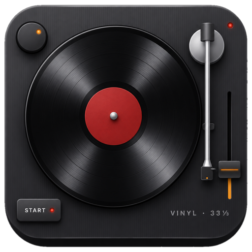

<p align="center"></p>

# HA Vinyl Player

Browse your **Discogs** record collection in Home Assistant with an Apple-style
**cover flow**. Tap the record in the centre: it slides out of its sleeve, drops
onto an animated **turntable**, the tonearm swings in, and the album plays
through **Music Assistant** (e.g. via Apple Music).

Like real vinyl you can't skip tracks. You get volume and stop, and that's it.
When the album is over, the needle sits in the run-out groove for a few
revolutions *(crackle… thump… crackle…)* and then the arm returns to its rest.

```
┌──────────────────────────────────────────────┐
│   ▯▯▯▯ ▯▯▯ [  ALBUM  ] ▯▯▯ ▯▯▯▯              │  ← swipe left / right
│              Artist – Album                   │
│  ┌────────────────────────────────────────┐  │
│  │   ╭──────────╮                    ◉    │  │
│  │  │  ◎ label   │               ╲  │  ▮  │  │  ← tonearm follows the
│  │   ╰──────────╯                  ╲│  ▮  │  │     album progress
│  │ [STOP]                            ▣  ▮  │  │  ← volume fader
│  └────────────────────────────────────────┘  │
└──────────────────────────────────────────────┘
```

## What's in the repo

| Part | Where | What it does |
|---|---|---|
| **1. Export script** | [`scripts/discogs_export.py`](scripts/discogs_export.py) | Exports your Discogs collection to `collection.json` and downloads all covers. Standard library only. |
| **2. Cover flow app** | [`custom_components/vinyl_player/frontend`](custom_components/vinyl_player/frontend/vinyl-player-panel.js) | A sidebar panel **and** a dashboard card (`custom:vinyl-player-card`): cover flow (swipe, drag, mouse wheel, arrow keys, search, sort, scrubber) plus the sleeve → platter animation. |
| **3. Turntable** | same panel | Spinning platter (33⅓ rpm), a tonearm that follows the album, START/STOP, a volume fader, the current side/track (e.g. `B2 · Here Comes the Sun`). No skip buttons. |
| **4. Playback** | [`custom_components/vinyl_player`](custom_components/vinyl_player) | A Home Assistant integration that plays the album via `music_assistant.play_media`. It turns off shuffle and repeat, detects when the album ends and plays the run-out sound. |
| NFC | integration + [docs](docs/nfc-and-shortcuts.md) | A list of tag → album links, a "scan to link" mode, HA Companion tags, and a webhook for an **Apple Shortcut**. |
| Run-out sound | `frontend/runout.mp3`, made by [`tools/generate_runout_sound.py`](tools/generate_runout_sound.py) | A locked groove, the arm lifting, the auto-return motor and the arm clicking into its rest. |

## Requirements

* Home Assistant **2024.12** or newer (tested with 2026.2)
* **Music Assistant** installed **and** added to HA (Settings → Devices & services → Music Assistant),
  with a streaming provider such as Apple Music and at least one player
* A wall tablet works well: the animations only use transforms and opacity, side covers use small
  cached thumbnails, and only about 15 covers are rendered at a time
* A Discogs account and a **personal access token**:
  [discogs.com/settings/developers](https://www.discogs.com/settings/developers) → *Generate new token*

## Installation

### HACS (custom repository)
1. HACS → ⋮ → *Custom repositories* → `https://github.com/niku85/ha-vinyl-player`, type **Integration**.
2. Install **Vinyl Player** and restart Home Assistant.

### Manual
Copy `custom_components/vinyl_player` to `<config>/custom_components/vinyl_player` and restart.

## Setup

1. Settings → Devices & services → **Add integration** → *Vinyl Player*.
2. Enter your **Discogs username** and **personal access token**. The token is checked against Discogs.
   If Music Assistant isn't set up, the setup stops and tells you so.
3. Pick the **Music Assistant player**, choose whether to show **vinyl only**, and pick where the
   **end-of-record sound** plays (speaker / browser / off).
4. Open **Vinyl Player** in the sidebar. The first sync exports your collection and caches every cover
   in `<config>/vinyl_player/covers/`. Later visits load from that local cache, so they're fast.

You can change the speaker, filter, sound and sync interval later under *Configure*.
To change the Discogs credentials, use *Reconfigure*.

## Using it

* **Sidebar or dashboard tab.** The integration adds a *Vinyl Player* sidebar entry. For a tab on a
  dashboard (e.g. the wall iPad), add a view of type **panel** with the card:

  ```yaml
  views:
    - title: Vinyl
      path: vinyl
      type: panel
      cards:
        - type: custom:vinyl-player-card
          # height: 720px   # optional; default fills the view
          # header: false   # hide search / sort / settings
          # look: frame     # light "Frame" style instead of the dark turntable
  ```
  The card is loaded automatically, so you don't need to add a resource.
* **Two looks.** The default is the dark, glossy turntable, which the sidebar panel always uses.
  `look: frame` on the card switches to the light paper style of the
  [Frame wall dashboard](https://github.com/niku85/ha-frame-dashboard). It has a heading with a black
  rule, a "Now spinning" panel with the side/track in Anton, and a flat, light turntable deck. It takes
  its colours and fonts from the `frame` theme (`--frame-ink`, `--frame-panel`, `--frame-font-display`, …),
  with sensible fallbacks without it.
* **Swipe** or drag the covers, or use the scroll wheel or the ← → keys. The slider underneath jumps through big collections.
* **Tap the centre cover** (or press Enter) to put the record on the turntable.
* **STOP** lifts the arm and stops playback. **START** drops the needle on the same record again.
* **Tap the turntable** to put the record away: the arm lifts, the platter stops, and the record flies
  back into its sleeve on the shelf. Playback stops too.
* **Pause** from anywhere else (HomePod, the MA app): the arm lifts and the platter coasts to a stop.
  Resuming spins it back up.
* **Volume**: the fader on the right of the plinth.
* **Speaker**: the round knob in the top-left corner of the turntable picks the speaker, like the
  selector knob on a classic deck. Tap it to turn to the next Music Assistant player; its light diode
  shows the position and glows while a record spins. Hold it for the full list. A record that's
  spinning moves over without restarting (Music Assistant queue transfer). The name pops up next to
  the knob, the choice is remembered, and the current speaker is also shown under the track. The
  default speaker in *Configure* is still the starting point.
* **START / STOP**: the rectangular button in the front-left corner, with a state LED.
* **Pause** (from the HomePod or the MA app) lifts the arm. **START** then resumes where it paused,
  instead of starting the album again.
* ⚙ → *This album*: if Music Assistant picks the wrong version (e.g. a deluxe edition), set its
  `ma_query`: a Music Assistant URI such as `apple_music://album/1441164426`, or a better search text.
  You can also hide the record from the shelf there.
* ⚙ → *Collection* → **Check all records** runs every album through Music Assistant search and lists
  the misses, each with MA's best guess. Press **Use** to store the guess as `ma_query`, or **Edit** to
  type your own. You can also call it as a service: `vinyl_player.check_matches`.
* Deep link: `/vinyl-player?release=<discogs release id>` opens the panel on that record.

If playback starts anywhere else (an NFC tag, the Shortcut, an automation, another tablet), every open
panel scrolls to the record and plays the same sleeve → platter animation.

## The export script

```bash
python3 scripts/discogs_export.py --username YOUR_NAME --token YOUR_TOKEN --output ./vinyl_player
# or: DISCOGS_TOKEN=... python3 scripts/discogs_export.py -u YOUR_NAME -o /config/vinyl_player
#   --all-formats   include CDs, cassettes, …
#   --no-covers     skip downloading covers
```

You can also pass them positionally, `discogs_export.py YOUR_NAME YOUR_TOKEN`. The script works from
`/config/scripts/` too: it finds the shared helpers in `/config/custom_components/vinyl_player/`.

You normally don't need it: the integration exports on first start and then re-syncs on its own
(every 24 h by default). That replaces the `shell_command` + nightly automation. The integration's
sync writes exactly the same format to `<config>/vinyl_player/`, so you can also run the script on
another machine and copy the folder over.

### Fields you can edit by hand

Each record in `collection.json` has three fields that **survive every re-export**, whether from the
integration or the script:

| Field | Meaning |
|---|---|
| `ma_query` | What Music Assistant should search for instead of *artist + title*, e.g. `"Pink Floyd - The Dark Side Of The Moon (Remastered)"`, or an exact URI like `apple_music://album/1065973699` |
| `tag_id` | The NFC tag(s) for this LP: a string, or a list if several tags or Shortcut names should start it |
| `hidden` | `true` keeps the record out of the cover flow. Its tags still work. |

The panel writes to these same fields when you pair a tag, fix a match or hide a record, so the file
stays the single place for them. After editing the file by hand, run `vinyl_player.sync` or reload
the integration.

<details><summary><code>collection.json</code> format</summary>

```json
{
  "version": 1, "source": "discogs", "username": "niku85",
  "generated_at": "2026-11-02T12:00:00+00:00", "count": 1, "vinyl_only": true,
  "releases": [{
    "id": 249504, "instance_id": 123, "master_id": 24047,
    "artist": "The Beatles", "artists": ["The Beatles"], "title": "Abbey Road", "year": 1969,
    "formats": ["Album", "LP", "Vinyl"], "format_text": "Vinyl, LP, Album", "vinyl": true,
    "genres": ["Rock"], "styles": ["Pop Rock"], "labels": ["Apple Records"], "catno": "PCS 7088",
    "cover_url": "https://i.discogs.com/…", "thumb_url": "https://i.discogs.com/…",
    "cover_file": "covers/249504.jpg", "thumb_file": "covers/thumbs/249504.jpg",
    "date_added": "2024-01-01T10:00:00-08:00", "rating": 0,
    "ma_query": null, "tag_id": "a1b2c3d4", "hidden": false
  }]
}
```
</details>

## NFC tags & Apple Shortcut

See **[docs/nfc-and-shortcuts.md](docs/nfc-and-shortcuts.md)**. In short:

* **ESP32 reader:** an ESP32 with a PN532 running ESPHome sends `tag_scanned` to HA. Put it in a
  puck next to the real turntable: lay the record down and the music starts. A config is in the docs.
* **Option A (no Shortcut):** open the panel in the HA app on your phone, swipe to the album, then
  ⚙ → *NFC tags* → **Write tag** and hold the phone to a blank sticker. That writes and links it in
  one go. For stickers that are already written, or an ESP32 reader, use **Scan tag to link**. After that, touching the tag starts the record.
* **Option B (Apple Shortcut):** an iOS NFC automation runs the *Play Vinyl* shortcut. The shortcut
  POSTs `{"tag": "<name>"}` to the integration's webhook and opens the panel. The panel shows the
  exact webhook URL.

There is one handler for the whole collection, so you don't write an automation per record. Links
are stored as each record's `tag_id` in `collection.json`. You can manage them in the panel, by hand
in the file, or with the `vinyl_player.link_tag` service.

## Services, events, entities

| Service | Data |
|---|---|
| `vinyl_player.play` | `release_id` **or** `tag_id` (returns the record) |
| `vinyl_player.stop` | – |
| `vinyl_player.sync` | – re-export from Discogs and cache any new covers |
| `vinyl_player.link_tag` | `tag_id`, `release_id` (leave it out to unlink), `name` |
| `vinyl_player.check_matches` | – searches every record in Music Assistant and returns the misses |

Events: `vinyl_player_album_started`, `vinyl_player_album_finished`, `vinyl_player_tag_learned`,
`vinyl_player_unknown_tag`.

Entities: `sensor.vinyl_player_turntable` (`idle` / `playing` / `runout`, with the cover as its picture)
and `sensor.vinyl_player_records` (collection size, last sync).

Example: switch the amplifier off 5 minutes after a record ends.

```yaml
automation:
  - alias: Amp off after the record
    triggers: [{ trigger: event, event_type: vinyl_player_album_finished }]
    actions:
      - delay: "00:05:00"
      - action: switch.turn_off
        target: { entity_id: switch.amplifier }
```

## How "end of album" is detected

When Music Assistant's player goes from *playing* to *idle* by itself, the integration checks two
things: was the last track within ~25 s of its end, and was it the last track of the Discogs
tracklist? If both are true, the album ran out. It then fires `vinyl_player_album_finished` and plays
`runout.mp3`, either on the speaker (Music Assistant fetches it from HA's internal URL) or in the
browser. If someone stops playback mid-album from another app, the session just ends quietly.

## Icon

The icon is in `custom_components/vinyl_player/brand/` (`icon.png` 256 px, `icon@2x.png` 512 px, plus
`dark_icon` variants). Home Assistant shows it for the integration from there, like the Chore Reminder.
The sidebar entry uses `mdi:record-player`.

## Development

```bash
python3 -m pytest tests            # helper + integration tests (needs pytest-homeassistant-custom-component)
python3 tools/generate_runout_sound.py   # re-create the run-out sound
```
